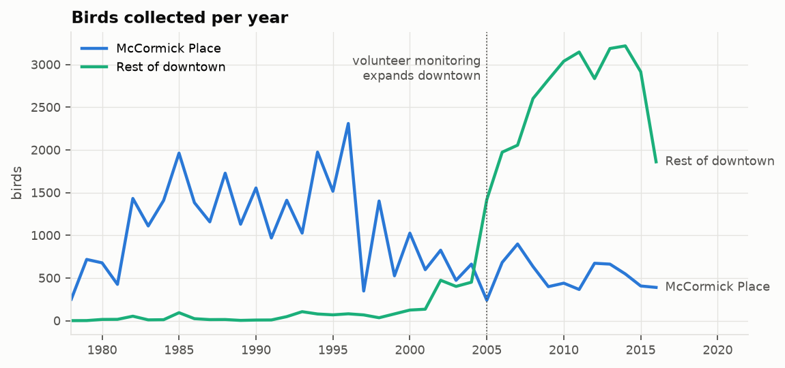
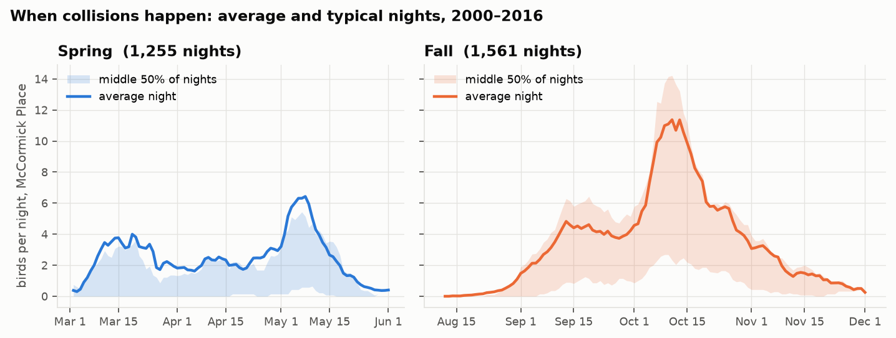
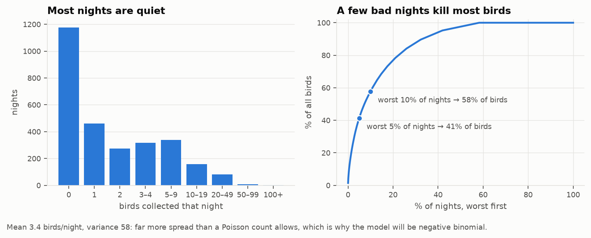
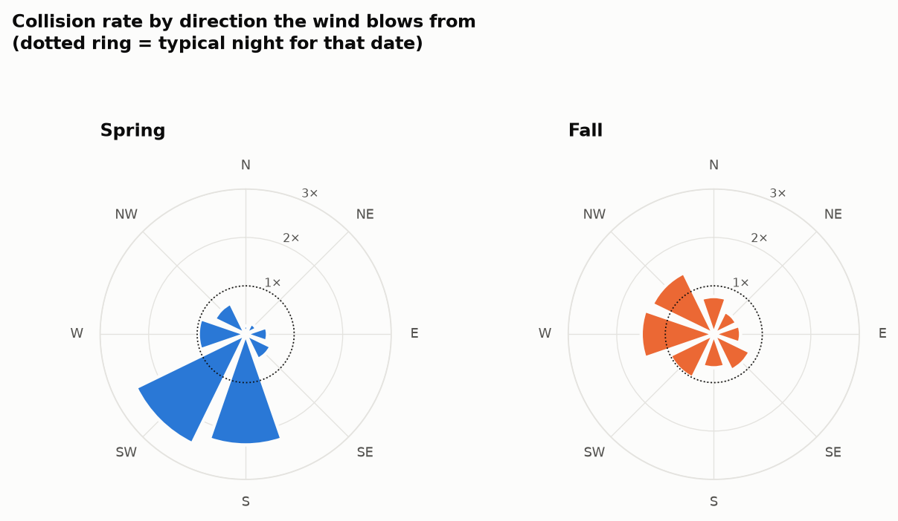
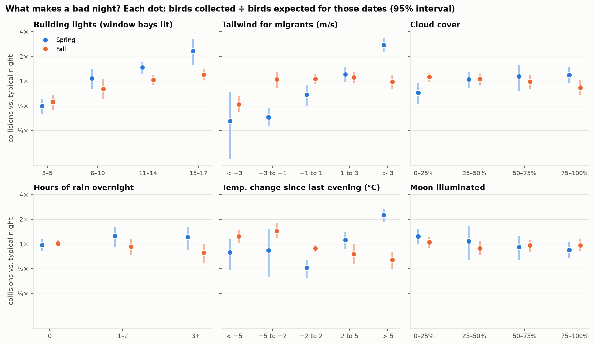

# First look at the data

Regenerate everything with:

```bash
uv run scripts/build_nightly.py   # -> data/processed/nightly.csv
uv run scripts/explore.py         # -> reports/figures/*.png
```

## The data

- **Collisions:** 69,784 birds of 91 species, 1978–2016, spring (Mar–May) and fall (Aug–Nov) only.
  Each record is one bird, with species, the date it was collected, and the place:
  McCormick Place (MP) or elsewhere downtown (CHI).
- **Light scores:** McCormick Place, 2000–2018, scored 3–17 (window bays lit). Each score shares
  its date with that morning's collisions; that alignment correlates best with counts
  (Spearman 0.35, vs. 0.29 and 0.33 with a one-day shift).
- **Weather:** O'Hare hourly reports, 1978–2019. Nightly features use 19:00–07:00 local time
  before the collection morning.

**Analysis set:** McCormick Place, 2000–2016, nights with a light score. A light score was
recorded on 97% of MP collision dates in that period, so those dates are the record of which
nights were surveyed, and a night with no birds there is a real zero. That gives
**2,816 nights and 9,637 birds**.

## Why only McCormick Place



Downtown counts jump about 30× after volunteer monitoring expanded in the mid-2000s. That's
more people looking, not more birds dying. McCormick Place was surveyed the same way the
whole time.

## When collisions happen



Fall peaks in early-to-mid October at about 11 birds a night. Spring is lower and peaks in
early-to-mid May. In spring the average sits above the middle 50% of nights: a few huge
nights pull it up.

## Bad nights are rare and extreme



42% of nights have no birds at all, yet the worst 5% of nights account for 41% of all birds.
The variance (58) is about 17× the mean (3.4), so a negative binomial model fits better
than a Poisson. This is the case for a forecast: catching the few bad nights is what matters.

## What makes a bad night

Each comparison divides the birds collected by the number expected from the date alone (a
seasonal curve scaled to each year's total), so the busy season doesn't masquerade as a
weather effect. These are one factor at a time; the model will separate overlapping effects.





| Factor | Spring | Fall |
|---|---|---|
| **Building lights**, 15–17 vs. 3–5 bays lit | 2.3× vs. 0.5× | 1.2× vs. 0.6× |
| **Tailwind** > 3 m/s (south wind in spring) | **2.8×** | ~1× (no effect) |
| **Headwind** > 3 m/s | 0.3× | 0.5× |
| **Temperature change** since last evening | warm-up > 5 °C: **2.3×** | cool-down 2–5 °C: 1.5×; warm-up > 5 °C: 0.6× |
| **Wind direction** | S and SW winds | W and NW winds a little above typical |
| **Rain** ≥ 3 hours | no clear effect | 0.65× |
| **Clouds** | clear skies 0.7× | no clear effect |
| **Moon** | slightly fewer at full moon (weak) | no effect |

**What stands out:**

- **Lights matter in both seasons.** Fully lit nights have roughly 2–4× the collisions of
  dark ones, which fits the Lights Out finding.
- **Spring has a clear weather signature:** a warm night with south winds after a cold
  spell. Those conditions launch big migration waves straight into Chicago.
- **Fall is subtler.** The pattern is the cold front: a cool-down plus west or northwest
  winds. A strong south headwind shuts migration down. The simple north–south tailwind
  feature misses the fall signal, so the model may need wind direction itself or a
  cold-front indicator.
- **Clouds, rain and moon are weak on their own.** They may still matter in combination
  (e.g. low clouds during a big flight), which the model can test.

## Caveats

- These comparisons are one factor at a time, and the factors overlap: warm spring nights
  usually come with south winds. The model is what separates them.
- Weather comes from O'Hare, about 25 km inland from McCormick Place on the lakefront.
- Light scores exist only from 2000 on. Before 2000 nobody recorded which nights were
  surveyed, so those years stay out of the main analysis.
