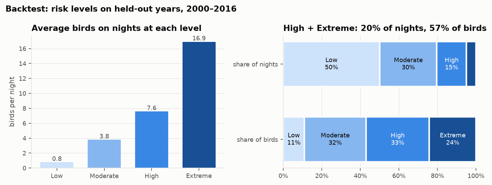
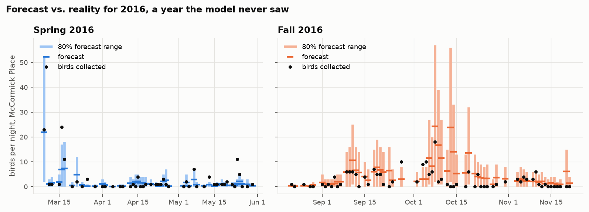
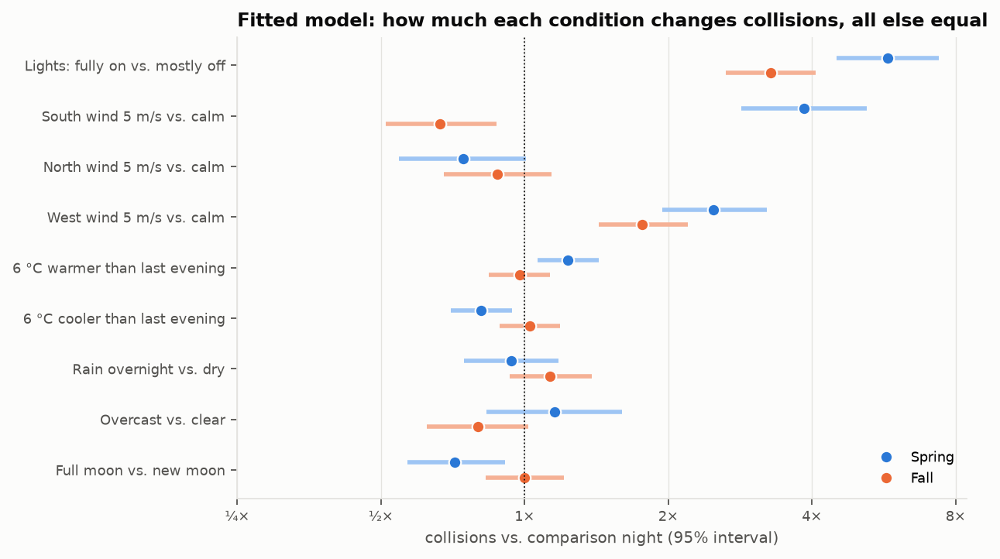

# The collision model

```bash
uv run scripts/build_nightly.py   # nightly table
uv run scripts/train.py           # backtest, fit, figures, models/collision_model.*
```

## What it is

A **negative binomial regression** for birds collected at McCormick Place each night
(2,645 surveyed nights, 2000–2016, 9,293 birds). The expected count is a product of:

- **Calendar:** a smooth seasonal curve (B-spline over the migration season) and a
  linear year trend. The trend is frozen at its 2016 level for later years.
- **Lights:** the McCormick Place light score (3–17 window bays lit).
- **Tonight's weather** at O'Hare, 19:00–07:00: wind components and speed, evening
  temperature, temperature and pressure change since the previous evening, sky cover,
  low cloud ceiling, rain, and moon illumination.
- **Last night:** tailwind, rain and temperature change the night before, and nights
  since the last good flying night (birds held back by bad weather).

Lights, weather and last-night terms each have separate spring and fall effects. The
dispersion is estimated at α ≈ 1.0, meaning the variance is roughly μ + μ²: far
noisier than Poisson.

Every input comes either from the NWS gridpoint forecast for tonight (temperature,
pressure, sky cover, ceiling, wind, precipitation) or from last night's observations,
so the live forecast can feed the model the same features it was trained on.

## How well it forecasts

Leave-one-year-out backtest: fit on 16 years, predict the 17th, repeat for every year.

| | Calendar only | Full model |
|---|---|---|
| Log score per night (higher is better) | −2.126 | **−1.951** |
| Rank correlation, predicted vs. actual | 0.42 | **0.66** |
| Worst 10% of nights that it flags in its top 10% | 24% | **41%** |



Risk levels split nights at the 50th, 80th and 95th percentiles of predicted collisions
(cutoffs ≈ 1.8, 5.7 and 12.7 birds). On held-out years:

| Level | Share of nights | Avg birds | Share of all birds | Share of the worst 10% of nights |
|---|---|---|---|---|
| Low | 50% | 0.8 | 11% | 4% |
| Moderate | 30% | 3.8 | 32% | 32% |
| High | 15% | 7.6 | 33% | 36% |
| Extreme | 5% | 16.9 | 24% | 28% |

**A Low night almost never turns out bad:** only 4% of the worst nights were rated
Low. High + Extreme nights are 20% of nights but 57% of birds, so turning lights off
on those nights alone would target most of the risk.



2016 is shown because it's the most recent year, not because it looks good. The
model rated March 9 Extreme (forecast 22, actual 23) and October 8 Extreme (forecast
24, actual 18). It under-called March 16 (High, forecast 7, actual 24) and raised a
false alarm on October 13–14 (Extreme both nights, forecasts 24 and 14, actual 0 and 0).

**Calibration:** split nights into ten equal groups by forecast. In each group, the
average forecast matches the average count within about 20%, except the riskiest
tenth: forecast 16.1, observed 12.6. The 80% forecast ranges contain the actual count
91% of the time, so they're a little wider than they need to be.

**Year-to-year totals are the weak spot.** Some years simply have more birds (2000: 497
forecast vs. 924 actual; 2005: 653 vs. 237), and nothing in the weather predicts that.
Within a season the night-to-night ranking is much better than the absolute level.

## What drives collisions



Each row compares two otherwise identical nights:

- **Lights are the biggest single factor:** fully lit vs. mostly dark is **5.8× in spring
  and 3.3× in fall**. This is also the only factor a person can control.
- **Spring south winds: 3.9×.** Tailwinds launch big northbound flights into the city.
- **West winds in both seasons (2.5× spring, 1.8× fall).** This wasn't obvious from
  the one-factor-at-a-time charts. West winds likely drift migrants east toward the
  Lake Michigan shoreline, where McCormick Place sits.
- **Fall south winds: 0.67×.** A headwind for southbound birds keeps them grounded.
- **Spring warm-ups: 1.23×** for tonight being 6 °C warmer than last evening.
- **Full moon in spring: 0.71×**, consistent with birds orienting better and being
  less drawn to artificial light under a bright moon. No effect in fall.
- Rain and cloud cover have small, uncertain effects once wind and lights are accounted for.

## Caveats and next steps

- **Light score at forecast time.** The building's lighting tonight isn't known in
  advance. The forecast will show risk with lights on vs. off (the 17 vs. 3 contrast),
  which is also the actionable message.
- **Forecast vs. observed weather.** The model was trained on observed weather but will
  run on forecasts. Expect some loss of skill, more on day 5 than on tonight.
- **One weather station.** O'Hare is about 25 km inland. Birds hitting Chicago in spring
  took off hundreds of km south, so upstream weather (e.g. St. Louis, Indianapolis) may
  add skill.
- **One building.** The model learns what makes a bad night at McCormick Place. Other
  downtown buildings likely share the weather pattern but not the light levels.
